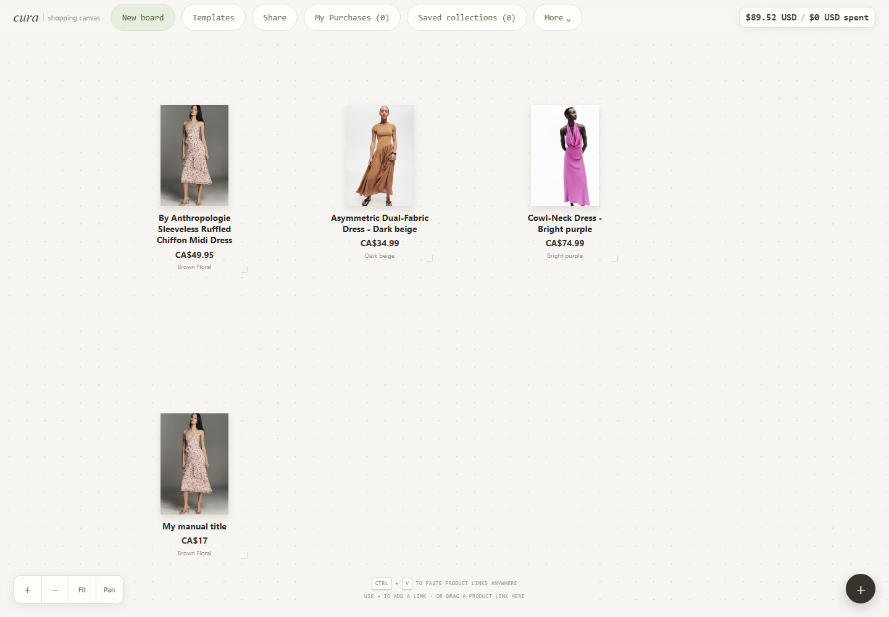
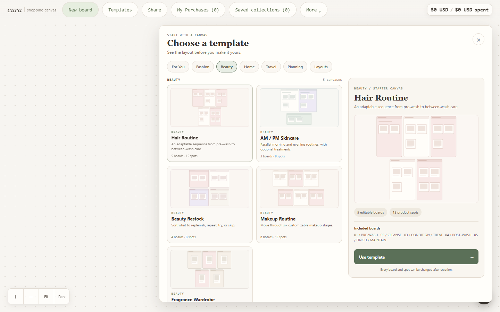
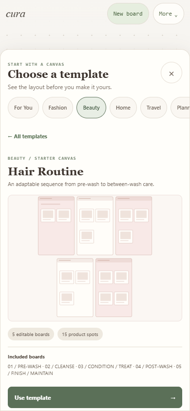
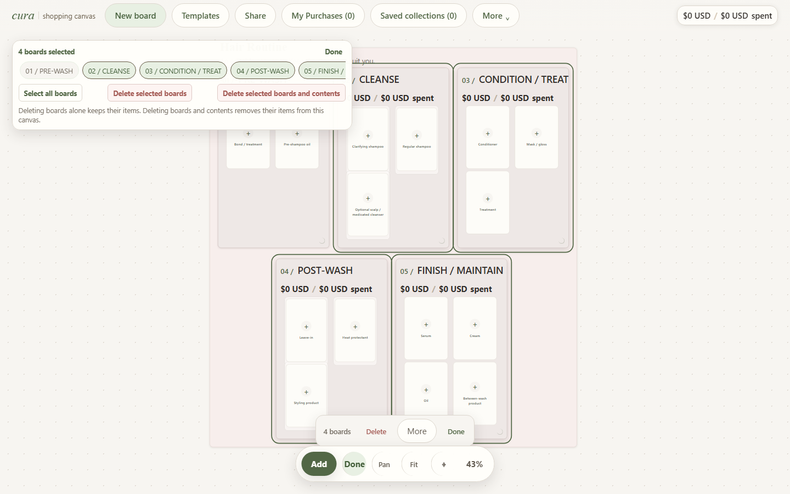
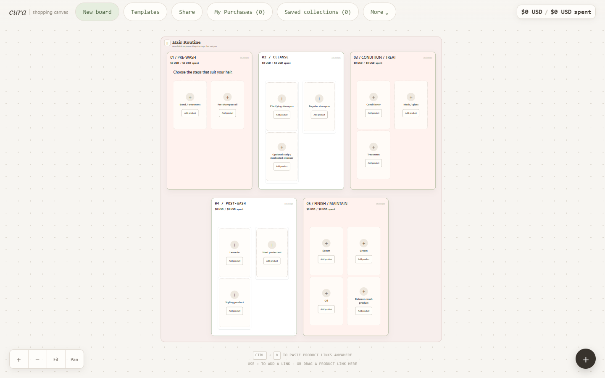

<div align="center">

# Cura

**A visual shopping canvas for saving products, planning purchases, and organizing ideas.**

*Local-first React application · Prototype / active development*

</div>

Cura turns products and images into movable cards on a flexible canvas. Rather than forcing everything into a conventional shopping list, you can collect links, arrange items spatially, build named boards, follow reusable planning templates, and keep track of budgets and purchase decisions.

> **Project status:** This repository contains the **October 26, 2026 source snapshot**, not a deployed production service. Some features depend on external retailers and optional API providers. Cloud accounts, cross-device sync, and reliable public sharing are **not implemented** in this snapshot.

## Preview

The images below are genuine screenshots included in the source archive. They illustrate the prototype and may differ from later builds.

### Product canvas



### Templates and planning

| Desktop template picker | Mobile template picker |
| --- | --- |
|  |  |

### Boards and routines

| Bulk board tools | Hair-routine planning template |
| --- | --- |
|  |  |

## What the prototype can do

- **Collect products:** paste product URLs, drop images, or create product cards with editable details.
- **Visualize and organize:** drag, select, move, resize, zoom, and pan around an open canvas; group products in named boards and sections.
- **Start from templates:** choose from 18 starter layouts across Fashion, Beauty, Home, Travel, Planning, and Layouts (`docs/TEMPLATES.md`).
- **Review purchase decisions:** track board budgets, prices, sizes, availability information, saved collections, and purchases using the prototype UI.
- **Resolve product metadata:** use retailer-provided product data when available and optional search-provider enrichment. Uncertain fields can stay blank for manual entry instead of being fabricated.
- **Match images to listings (optional):** use a separately configured, user-reviewed visual-search path.
- **Use multiple screen sizes:** the project contains responsive canvas behavior, touch-oriented task tests, and accessibility/keyboard work.

## Tech stack

| Layer | Technologies |
| --- | --- |
| UI | React 19, TypeScript, CSS |
| Development/build | Vite 8, Node.js, npm |
| Local API | Node.js, Express 5 |
| Data | Browser `localStorage` and local API-side caches |
| Product enrichment | Retailer extraction with optional Tavily / Firecrawl integration |
| Tests / QA | Node test runner; project-specific Playwright QA scripts |

## Run Cura locally

**Requirements:** Node.js 22.12+ and npm. Internet access may be needed to install dependencies and for live retailer/product features.

```bash
# After cloning the repository:
npm ci

# Run the React app and local Express API together:
npm run dev
```

Open the local address printed by Vite (typically `http://localhost:5173`). The API defaults to `http://localhost:8787`; Vite proxies `/api` to the API.

For optional provider integrations, first create your local configuration file:

```bash
cp .env.example .env
```

On Windows PowerShell, use `Copy-Item .env.example .env` instead. Add only the credentials for services you actually wish to use, and restart the local server. API provider services may charge for usage; review their limits first.

| Environment variable | Purpose |
| --- | --- |
| `TAVILY_API_KEY` | Optional indexed search / product enrichment |
| `FIRECRAWL_API_KEY` | Optional fallback extraction / enrichment |
| `SERPAPI_KEY` | Optional user-reviewed visual product matching |
| `ROBOFLOW_API_KEY` | Optional outfit-image extraction endpoint |
| `GOOGLE_WEB_RISK_API_KEY` | Optional web risk provider |
| `GOOGLE_VISION_API_KEY` | Optional image safety provider |
| `TAVILY_MONTHLY_CAP`, `FIRECRAWL_MONTHLY_CAP`, `SEARCH_DAILY_CAP` | Local development-level provider use caps |
| `DEFAULT_COUNTRY`, `RESOLVER_SCHEMA_VERSION` | Resolver defaults / cache versioning |

The `.env` file is intentionally **not committed**. Never place actual credentials in source files, screenshots, issue threads, or Git history.

## Useful commands

```bash
npm run dev               # Vite + local API
npm run api               # Local API only
npm test                  # Node.js test suite
npm run build             # TypeScript check + production frontend bundle
npm run preview           # Preview built frontend
npm run resolver:test -- https://example.com/product  # Diagnose a product link
```

The final command uses a placeholder URL; substitute a real public product listing. Provider configuration and network access affect resolver behavior.

## Project layout

```text
src/                  React application, components, styling, canvas utilities
server.mjs            Express API and product/media endpoints
productResolver.mjs   URL validation, product identity and resolution logic
server/resolver/      Resolver providers and supporting services
tests/                Automated Node tests
docs/                 Product, UI, accessibility and architecture documentation
docs/images/          Selected screenshots from the source archive
scratch/*.mjs         Developer QA / browser-check scripts
```

See `docs/PRODUCT_RESOLUTION.md` for the resolver workflow and `docs/TEMPLATES.md` for template behavior. Reports in `docs/` describe checks performed during earlier development; they are **historical records, not a fresh certification** of this uploaded snapshot.

## Important prototype limitations

1. **Local-only persistence:** boards and preferences live primarily in the browser's local storage. Clearing that storage can remove your work; there is no account-based backup or multi-device sync.
2. **Sharing is experimental:** collection IDs and published data are stored locally, so a copied `?collection=...` URL is not a dependable link for another user/device.
3. **Pricing and product data are best-effort:** retailer pages, providers, market/currency specificity, variants, and availability can affect accuracy. Review details before buying anything.
4. **Quota and ownership controls are not production-grade:** browser-side counters and locally generated visitor identifiers are not a substitute for authenticated, server-enforced billing, abuse protection, or access controls.
5. **Not release-ready:** production security, public storage, authentication, privacy controls, complete automated verification, and cross-device UX checks are still future work. General-purpose Undo/Redo is not yet available.

The roadmap and risks were documented in the accompanying project handoff (2026-10-26). This README intentionally avoids presenting planned features as already shipped.

## Source snapshot and licensing

**Snapshot date:** October 26, 2026. Prepared from the owner's archived `shopping-canvas (3).zip`. The large original archive contained local `.env` configuration, dependencies, Playwright browser binaries, caches, and generated logs; these are deliberately excluded from this clean GitHub-ready source tree.

No open-source license is granted by the presence of this repository. A license can be added later if the project owner decides to publish the source under specific terms.
